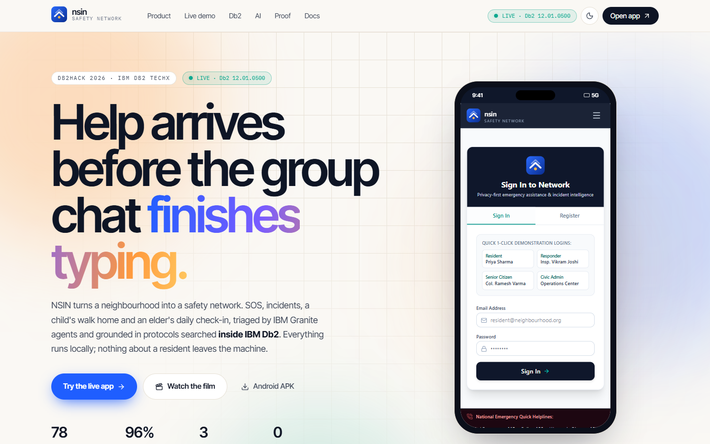
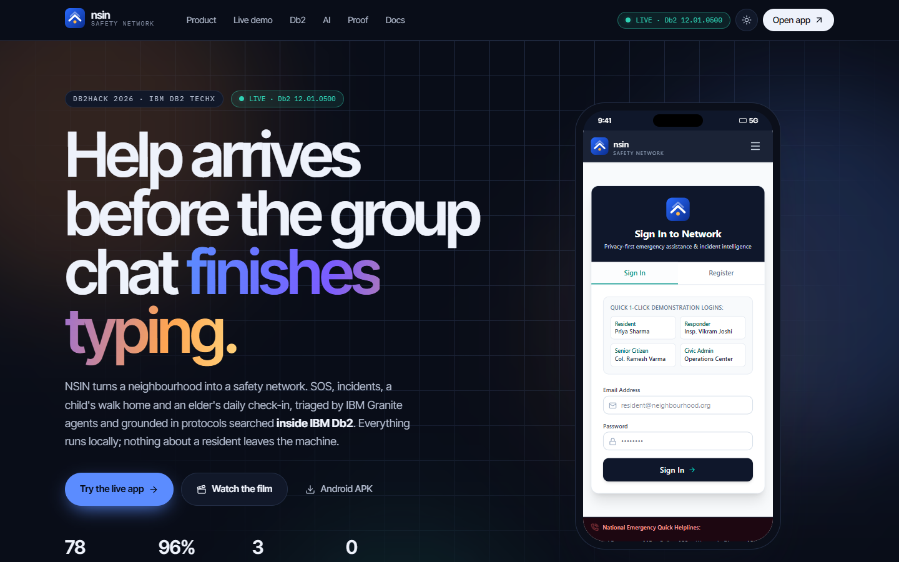
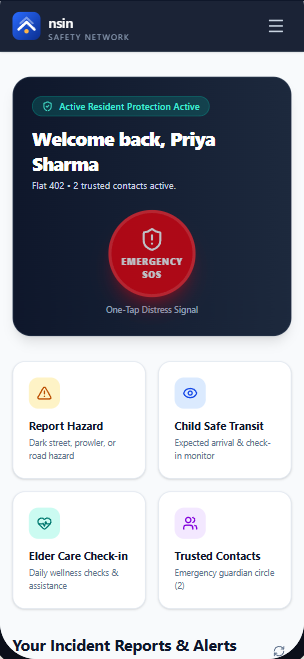

<div align="center">


# nsin · Neighbourhood Safety Intelligence Network

**Help arrives before the group chat finishes typing.**

[**▶ Live site**](https://ibm-db2-tech-x-project-submission-n.vercel.app) ·
[Open the app](https://ibm-db2-tech-x-project-submission-n.vercel.app/app/) ·
[Android APK](https://ibm-db2-tech-x-project-submission-n.vercel.app/downloads/nsin-android.apk) ·
[Source code & docs](https://github.com/YagnikSharma/IBM_Db2_TechX_Project_Submission/tree/submission/neighbourhood-safety-intelligence-network/submissions/neighbourhood-safety-intelligence-network) ·
[Judge's guide](https://github.com/YagnikSharma/IBM_Db2_TechX_Project_Submission/blob/submission/neighbourhood-safety-intelligence-network/submissions/neighbourhood-safety-intelligence-network/docs/JUDGES_GUIDE.md)

-1f5eff)


</div>

<br />

[](https://ibm-db2-tech-x-project-submission-n.vercel.app)

This repo holds the **website** for NSIN, our Db2Hack 2026 entry. The product itself (FastAPI backend, web app, Android app, tests and docs) lives in the [submission folder](https://github.com/YagnikSharma/IBM_Db2_TechX_Project_Submission/tree/submission/neighbourhood-safety-intelligence-network/submissions/neighbourhood-safety-intelligence-network).

## What makes this site different
- **The real app, not a mock-up.** The actual NSIN web app is served at `/app/`. It runs inside a phone frame, a desktop browser frame and a full-screen "immersive" view, and talks to the real backend: IBM Db2 12.1 plus IBM Granite on Ollama.
- **Proof you can click.** The Proof section calls the live API: the Granite crew briefing, Haystack hybrid search on Db2, and Db2 SQL analytics. When the backend is off, it shows recorded real responses, labelled with their date and Db2 version.
- **Honest status.** A pill reads `LIVE · Db2 12.01` or `BACKEND OFFLINE · RECORDED MODE`. Nothing pretends.
- **Light "hope" theme with a full dark mode.** Every colour is a CSS token, so dark mode switches the whole page, not just the background.

| Light | Dark | Live sign-in inside the phone |
|---|---|---|
|  |  |  |

## How the live demo works
```
Visitor ──► Vercel (this site + /app/) ──reads──► /live.json { apiUrl }
   │
   └──HTTPS──► Cloudflare tunnel ──► FastAPI ──► IBM Db2 12.1
                                            └──► Ollama · IBM Granite
```
The web app and the Android APK both read the backend URL from `site/public/live.json` at start-up. A new tunnel only needs a one-line change to that file, with no rebuild. The full write-up is in [LIVE_DEMO.md](https://github.com/YagnikSharma/IBM_Db2_TechX_Project_Submission/blob/submission/neighbourhood-safety-intelligence-network/submissions/neighbourhood-safety-intelligence-network/docs/LIVE_DEMO.md).

## Run the site locally
```bash
cd site
npm ci
npm run dev            # http://localhost:5173
npm run build          # strict TypeScript + production build
```

Rebuild the embedded web app from the submission repo (only needed after app changes):
```bash
bash scripts/build-app.sh   # set WEB_APP=<path to src/web-app> if it lives elsewhere
```

## Point the site at a live backend
1. Start the backend with `CORS_ORIGINS` including the site URL.
2. Run `cloudflared tunnel --url http://localhost:8000`.
3. Put the tunnel URL in `site/public/live.json` → `"apiUrl"`, then commit and push. Vercel redeploys in about a minute.

## Deploy
Vercel reads `vercel.json` at the repo root. It installs and builds in `site/` and serves `site/dist`, with `live.json` set to `no-store`. Import the repo and keep the Root Directory as `./`; no other settings are needed.

## Stack
React 18 · TypeScript · Vite · Tailwind CSS v4 · Motion · lucide-react · Inter Tight and IBM Plex Mono

## Built for
[Db2Hack 2026 · IBM Db2 TechX](https://ibmdb2techxsummit.glbajajgroup.ac.in/). Open source.
